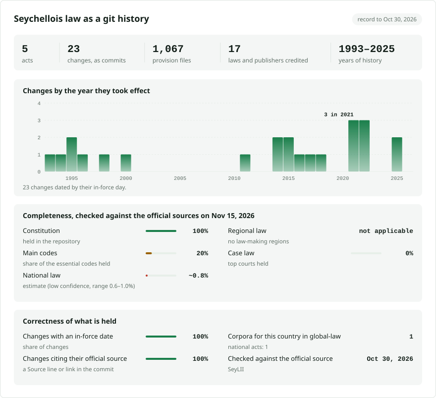

# Seychelles: law history in git

<picture>
<source media="(prefers-color-scheme: dark)" srcset="data/effort-dark.svg">

</picture>

The law of Seychelles as a git history: one file per article or section, one commit per change on the day it took effect, and the law that made each change as the commit's author. `git blame` names the law behind every paragraph; `git log` lists every change to an article; picking a date gives the text in force that day.

Part of [lexifina/global-law](https://github.com/lexifina/global-law), one git history for every country's law: this is Seychelles' national law, which global-law reads at `seychelles/national/acts/`.

**What is in it now:** the Constitution (14 versions, 1993 to 2025) and 4 older acts as SeyLII consolidated them (Civil Status Act, Commercial Code, Evidence Act, Civil Code of 1976); 157 Acts as enacted from the Official Gazette (2019 to 2026), among them the Civil Code of Seychelles Act, 2020 with all its articles; and 0 statutory instruments. [`STRUCTURE.md`](STRUCTURE.md) gives the layout and dating rules; [`REPRODUCE.md`](REPRODUCE.md) how it was built.

Each act is a folder, one file per provision, plus a `README.md` listing its provisions and their changes (`constitution/art-081.md` is Article 81 of the Constitution, vacation of seats in the National Assembly; the Commercial Code's articles are in its First Schedule, `acts/1976/005-commercial-code/sch-01-art-001.md`).

The text is in English, as SeyLII publishes it; its editorial notes (kept only where a provision has no other text) and the Part and Chapter headings are left out.

## Questions as git commands

| Question | Command |
| --- | --- |
| Every change to Article 81 of the Constitution | `git log -p --word-diff -- constitution/art-081.md` |
| Which law wrote each line of Article 81? | `git blame constitution/art-081.md` |
| Every version of the Constitution, with the day each took effect | `git log --format="%h %(trailers:key=In-force,valueonly,separator=) %an" -- constitution ':!constitution/README.md'` |
| Article 81 as in force on 1 January 2000 | `python tools/on.py 2000-01-01 constitution art-081` |

**Outside git**, we also host this record publicly, for free:

- **[Ask Claude about Seychellois law](https://global-law.lexifina.com/v1/try_claude?country=seychelles)**: opens Claude with a first question ready.
- **[Ask ChatGPT](https://global-law.lexifina.com/v1/try_chatgpt?country=seychelles)**: the same question in ChatGPT.
- **[Search Seychellois law on our site](https://lexifina.com/law?country=seychelles&q=marriage)**: a search for "marriage", with each provision's text and its versions, no account needed.
- **[Developer REST API](https://global-law.lexifina.com/v1/search_law?query=marriage&jurisdiction=seychelles)**: the same search as JSON, with no key. See the [documentation here](https://lexifina.com/api/global-law).

Both assistants read the record through the free Global law connector (MCP, `https://global-law.lexifina.com/mcp`); the first time, the chat gives you the link that adds it. Ask in English.

**Host it yourself easily.** All it takes is git and Python, and the tools run on your machine:

```sh
git clone --depth 1 https://github.com/lexifina/global-law && cd global-law
python3 tools/countries.py add seychelles/national/acts
python3 tools/law.py show 2026-01-01 seychelles/national/acts/constitution/art-081.md
```

Opened in Claude Code, Cursor, VS Code or Codex, the clone also starts a local MCP server with the same tools ([MCP.md](https://github.com/lexifina/global-law/blob/main/MCP.md)).

## Dates

Each commit is dated at noon, Indian/Mahe, on the day the version took effect, and carries it in its `In-force:` trailer. The day is SeyLII's, the date of its point-in-time version (expression):

- for an amendment, the day it came into force, as SeyLII's amendment list gives it; an Act that came into force in stages has a commit for each day (Act 14 of 1996: 14 August 1996 and 21 February 1998);
- for an act's oldest version, a SeyLII consolidation, the day it is as at: 1 December 2014 (Commercial Code, Evidence Act) or 31 December 2015 (Civil Status Act, Civil Code of 1976);
- for the Constitution as adopted, 21 June 1993, the day SeyLII gives it.

Each change is credited to the amending Act SeyLII's History names (`Act 14 of 2024 <act-2024-14@seylii.invalid>`), and a provision only to an Act its editorial note names where one version takes in several. The first version of the Constitution is credited to the Constitution of 1993; for the other 4 acts it is the "oldest version available", credited to the publisher (`SeyLII`).

## How it is checked

- `tools/check_repo.py` reads every version back from git on the day it took effect and on the day before, and compares it with the corpus: 23 versions of 5 acts, 0 mismatches, and no commit whose trailers git cannot parse (see [`REPRODUCE.md`](REPRODUCE.md)).
- Every version is parsed from an archived copy of its own dated SeyLII page, whose sha256 is recorded in [`data/versions.json`](data/versions.json); every text of a version, except the headings and notes left out, is checked to be in a provision file.
- The provisions inserted or substituted by the Constitution's last three amendments (Acts 13 of 2022, 14 of 2024 and 6 of 2025) and by the Civil Status (Amendment) Act, 2021 were compared with those Acts in the Supplement to the Official Gazette: the same word for word, two full stops and a Gazette misprint aside.
- History is append-only: no merge commits, no commit dates that go backwards, and none after the build.
- [vulnerabilities/](vulnerabilities/): possible drafting mistakes in this law, found by global-law's detectors and checked by hand. Not run yet.

## What it does not show

- **Most Seychellois law before 2020, consolidated.** The Gazette site carries Acts and S.I.s from 2020 only, each as enacted: an amending Act is its own folder, not applied to the act it amends. Consolidated texts of the Penal Code, Criminal Procedure Code, Employment Act and Companies Act are not available from an official source we can read (SeyLII is out of reach). Acts awaiting a commencement notice, scanned PDFs (no OCR is run) and Acts the parser could not split cleanly are held back.
- **Earlier history, and gaps.** Changes before an act's oldest SeyLII version are folded into it, and a change between two SeyLII versions arrives with the later one. SeyLII has no Civil Status Act version between 2015 and 2021, so the Civil Status (Amendment) Act, 2018 arrives on 1 July 2021.
- **The Constitution's 2020 consolidation.** SeyLII's 2020 text rewords 97 articles and is not the base of its next version, so the 2022 version follows the 2018 one directly.
- **Amendments SeyLII has not applied to its text**, except the Commercial Code's 2021 amendments (Act 24 of 2021), applied here from the Act as printed in the Supplement to the Official Gazette.
- **Changes within a line.** Each paragraph is one line, so blame credits a whole paragraph to the law that changed one word of it.

## Sources

| Source | Kind | Past versions | Notes |
| --- | --- | --- | --- |
| [SeyLII](https://seylii.org) (Seychelles Legal Information Institute; Laws.Africa) | Consolidated legislation | yes, dated point-in-time versions | The text and date of every version, its amendment history, and the editorial notes used for credits |
| [Internet Archive](https://web.archive.org/) | Archived copies of SeyLII's pages | as captured | Each version is read from the copy of its own dated page |
| [Official Gazette](https://www.gazette.sc) (Supplement) | Acts and statutory instruments as enacted or made, 2020 onwards | as published | The text layer of each PDF, its publication day and its commencement notice; also the text of Act 24 of 2021 for the Commercial Code, and the Gazette checks above |

## Licence

See [`LICENSE`](LICENSE). SeyLII licenses its content under CC BY-NC 4.0, crediting SeyLII as the source (its terms of use, section 9), so the texts may be used only for non-commercial purposes. The Acts and statutory instruments under `acts/<year>/` and `subsidiary/` from 2020 onwards are official texts of the Republic of Seychelles as published in the Official Gazette of Seychelles. Lexifina's own contributions (the arrangement of the history, the commit messages, the tables and the tools) are CC0 1.0.

No AI model wrote, translated or corrected legal text, and none runs when the history is built; the scripts and the configuration were written, and the acts chosen, by an AI model (see [`REPRODUCE.md`](REPRODUCE.md)).

## Visualisations

- [visualisations/](visualisations/): charts drawn from this repository. Not drawn yet.

## More

From [lexifina/global-law](https://github.com/lexifina/global-law):

- [FEATURES.md](https://github.com/lexifina/global-law/blob/main/FEATURES.md): every feature, and what every corpus must support (`git blame`, `law.py`, the MCP tools)
- [FAQ.md](https://github.com/lexifina/global-law/blob/main/FAQ.md): questions and answers · [CONTRIBUTING.md](https://github.com/lexifina/global-law/blob/main/CONTRIBUTING.md): proposing changes · [MCP.md](https://github.com/lexifina/global-law/blob/main/MCP.md): the MCP server · [REPRODUCE.md](https://github.com/lexifina/global-law/blob/main/REPRODUCE.md): how it was built · [CHANGELOG.md](https://github.com/lexifina/global-law/blob/main/CHANGELOG.md)
- [FRESHNESS.md](https://github.com/lexifina/global-law/blob/main/FRESHNESS.md): how current each corpus is · [Monitoring](https://github.com/lexifina/global-law/tree/main/monitoring): whether updates are running · [WATCHING.md](https://github.com/lexifina/global-law/blob/main/WATCHING.md): how each official source is watched for changes
- [performance/](https://github.com/lexifina/global-law/tree/main/performance): how fast the tools are, measured
- [visualisations/](https://github.com/lexifina/global-law/tree/main/visualisations): charts and bridges across the world's law
- [Vulnerabilities](https://github.com/lexifina/global-law/tree/main/vulnerabilities): mistakes in legislation as published
